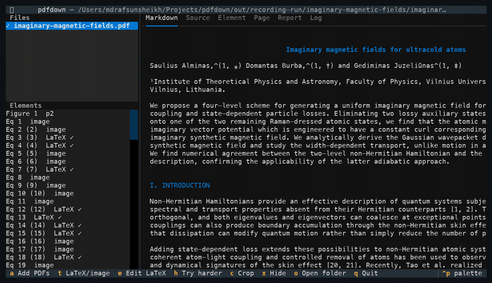

**Timeline:** November 2026 - Present

- **Project Description:** pdfdown is a terminal app that turns PDFs, especially research articles, into clean Markdown you can read, search, quote and edit. Two-column pages become one continuous column, hyphenated words are joined again, tables are rebuilt, and figures are cropped and placed where they belong with their captions. Every equation starts as a cropped image and is replaced by LaTeX only after the LaTeX has been checked against the PDF itself. In the app you can switch equations between LaTeX and image, fix LaTeX with a live check, and adjust crops. Everything runs on your own computer, so unpublished papers stay private. Built with Python.

- **Project Link:** [pdfdown on PyPI](https://pypi.org/project/pdfdown/)

- **Install:** `uv tool install pdfdown` or `brew install rafsunsheikh/tap/pdfdown`
